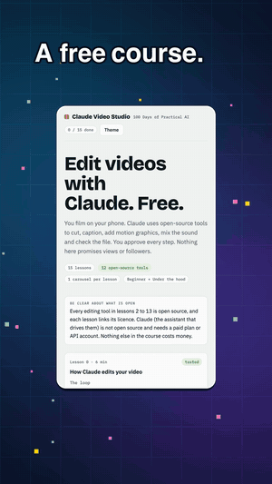
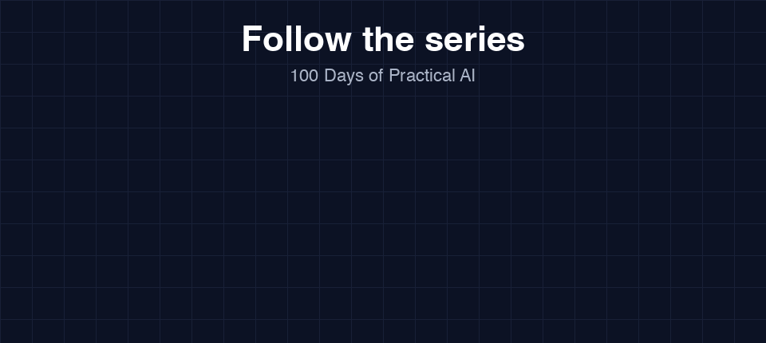
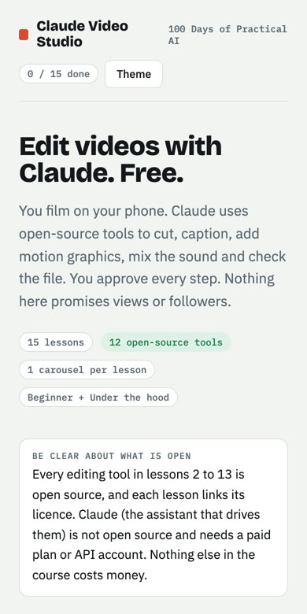
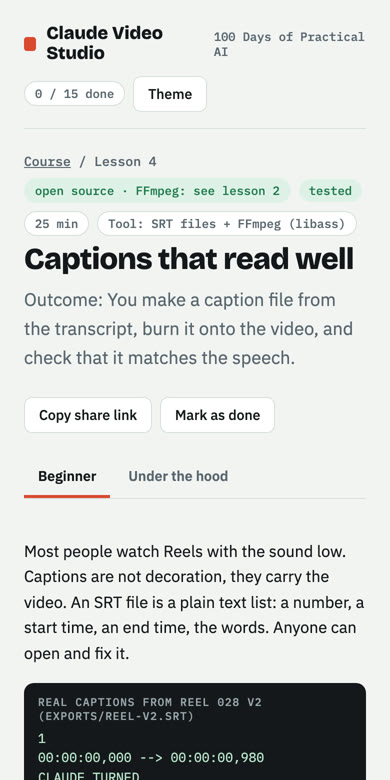
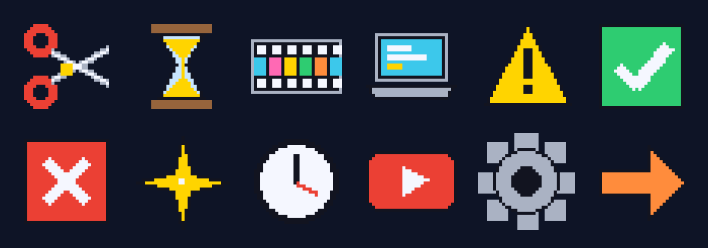
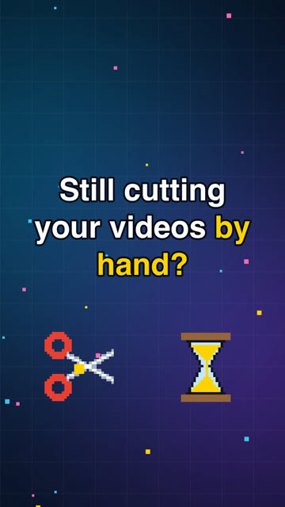
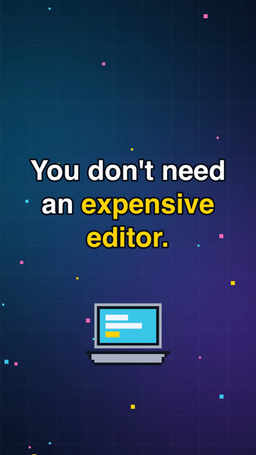

<div align="center">

# Claude Video Studio

### Learn to edit video with Claude and free, open-source tools.
**A free beginner course. 15 lessons. Real commands, real outputs, honest limits.**

[**Start the course →**](https://rksingh95.github.io/claude-video-artifacts/) &nbsp;·&nbsp; [**See the studio repo**](https://github.com/rksingh95/calude-video-studio) &nbsp;·&nbsp; Part of **100 Days of Practical AI** by [@imsikarwar.rahul](https://www.instagram.com/imsikarwar.rahul/)



</div>

---

## Follow the series

New lessons, Reels and carousels land on all three. Pick the one you use.

<p align="center">
  <a href="https://www.youtube.com/@practicetogetheral"></a>
</p>

<p align="center">
  <a href="https://www.youtube.com/@practicetogetheral"><b>YouTube</b></a> &nbsp;·&nbsp;
  <a href="https://www.instagram.com/imsikarwar.rahul/"><b>Instagram</b></a> &nbsp;·&nbsp;
  <a href="https://www.facebook.com/rahulsankrit/"><b>Facebook</b></a>
</p>

## Why this course exists

Claude does not watch your video like a person. It reads a transcript, runs open-source tools to cut, caption and mix, and **measures the result with scripts**. This course teaches every one of those tools, one lesson each, so you know what is happening and can check it yourself.

The Reels behind this course **failed their own checks** on the way. Reel 008 had a sound peak of -1.7 dBTP against a -2.0 limit, then captions about 0.27 s early on average. Reel 028, the Reel about that edit, had captions lagging the speech by up to 1.3 s in its first export. Each was found by measuring, and Reel 028 version 2 passed (largest caption offset 0.08 s, true peak -3.1 dBTP). That is the course in one sentence: edit with AI, then check.

<p align="center">
  
  &nbsp;&nbsp;
  
</p>

## What you will learn

| # | Lesson | Tool | Licence |
|---|---|---|---|
| 0 | How Claude edits your video | the loop | n/a |
| 1 | Set up your studio | Claude Code | closed source, paid plan |
| 2 | Look inside a clip, cut it, straighten it | FFmpeg | LGPL / GPL |
| 3 | Turn speech into timed words | faster-whisper | MIT |
| 4 | Captions that read well | SRT + FFmpeg | see FFmpeg |
| 5 | Remove the room behind you | Robust Video Matting | GPL-3.0 |
| 6 | Motion graphics from plain HTML | HyperFrames | Apache-2.0 |
| 7 | Effects that follow your face | claude-video-effects | MIT |
| 8 | Cutting by reading the transcript | video-use helpers | MIT |
| 9 | Sound: speech first, loudness measured | FFmpeg audio filters | see FFmpeg |
| 10 | Real screen demos you can prove | Playwright | Apache-2.0 |
| 11 | Learn from videos without copying | yt-dlp | Unlicense |
| 12 | Check your video like a reviewer | ffprobe + scripts | MIT |
| 13 | Export for Instagram | FFmpeg (x264) | GPL build |
| 14 | Capstone: one Reel, start to finish | everything | n/a |

Every lesson has a **Beginner** tab and an **Under the hood** tab, a "Verified / Not verified" list, a short "Check yourself" quiz, and an Instagram carousel for sharing.

## Honest about what is open

Every editing tool in lessons 2 to 13 is open source and each lesson links its licence. **Claude itself is not open source and needs a paid plan or API account.** The official setup page lists the plans; lesson 1 says so too. Nothing else in the course costs money. Nothing here promises views or followers.

## Made with pixel art and real recordings

The two promo Reels for this course are faceless: the pixel art is drawn by code, the screen windows are real recordings of this site.

<p align="center">
  
</p>
<p align="center">
  
  &nbsp;&nbsp;
  
</p>

## Run it yourself

The course is a static site (plain HTML, CSS and JavaScript, no build step).

```bash
git clone https://github.com/rksingh95/claude-video-artifacts.git
cd claude-video-artifacts
python3 -m http.server 8000      # then open http://localhost:8000
```

Opening `index.html` directly also works.

### Scripts used in lessons 4, 12 and 13

`scripts/` holds four small Python scripts that need only Python 3 and FFmpeg/ffprobe on your PATH:

| Script | What it does |
|---|---|
| `scripts/spec_check.py` | checks an MP4 against the Instagram Reel specs we recorded (read-only) |
| `scripts/pacing_check.py` | reports when the picture changes and the longest still stretch |
| `scripts/caption_check.py` | compares caption start times with spoken word times (read-only) |
| `scripts/hq_export.py` | one high-quality H.264/AAC export with the settings from lesson 13 |

The Instagram numbers inside `spec_check.py` are our reading of Instagram's help pages and API notes. They can change.

## Want the whole studio?

The full editing pipeline behind this course (render, QA and export scripts, effects wiring, skills and real episode evidence) lives in the studio repository:

**[rksingh95/calude-video-studio](https://github.com/rksingh95/calude-video-studio)**: the working studio that produced the Reels this course is built on.

Everything you need for the lessons is in this repo and in each tool's own repository, linked on every lesson.

## Credits and third-party licences

- [FFmpeg](https://ffmpeg.org/), [faster-whisper](https://github.com/SYSTRAN/faster-whisper), [OpenAI Whisper](https://github.com/openai/whisper), [Robust Video Matting](https://github.com/PeterL1n/RobustVideoMatting), [HyperFrames](https://github.com/heygen-com/hyperframes), [Playwright](https://github.com/microsoft/playwright), [yt-dlp](https://github.com/yt-dlp/yt-dlp), [video-use](https://github.com/browser-use/video-use), and the face-effects pack by [Vibha Ramprakash](https://github.com/Vibha-Ramprakash/claude-video-effects). Each keeps its own licence; none of their code is copied into this repository.
- Course text, site code and the four scripts: MIT (see `LICENSE`).
- The photos in the lessons and the Reel covers show the author. Please do not reuse them as your own.

## Found a mistake?

Open an issue. A wrong command or licence is a bug in the course, and we will fix it and say so.

---
<div align="center">Made by Rahul · 100 Days of Practical AI<br><a href="https://www.youtube.com/@practicetogetheral">YouTube</a> · <a href="https://www.instagram.com/imsikarwar.rahul/">Instagram</a> · <a href="https://www.facebook.com/rahulsankrit/">Facebook</a></div>
